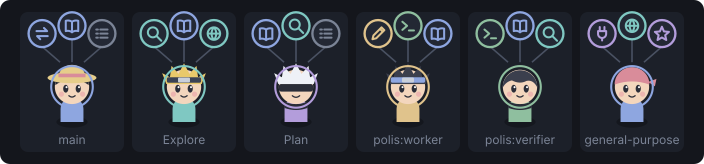

# Polis user manual

How to read the Polis dashboard in Claude Code: the band above the prompt, the city, and the other views of the pane.

- [Getting started](#getting-started)
- [Using Polis in VS Code](#using-polis-in-vs-code)
- [Reading the city](#reading-the-city)
- [Attention, checks and verification](#attention-checks-and-verification)
- [The other views](#the-other-views)

The pictures are the mod's own drawings of made-up sessions. `tools/manual-images.ts` regenerates them.

## Getting started

### What Polis is

Polis is a mod for Claude Code that keeps a large piece of work legible while Claude does it. It follows Claude's task list, its subagents, its background processes and what each prompt costs, and shows them in a band above the prompt and in a pane with seven views. One of the views is an isometric city: each district is a work area, each building is a task, and each agent stands on the building it is working on.

It watches the whole project and not one session alone. Tasks an earlier session left unfinished are still on the board, every session is written into the project's log (the Project view), and the usage limits of your account are tracked across all your sessions. It also tells you what needs you (a permission, a question, a plan to approve), when a usage limit is on course to run out before it resets, whether the tests, lint, type check and build have passed since the last edit, and which finished tasks something has checked. [Attention, checks and verification](#attention-checks-and-verification) covers those.

### Where it draws

| Host | What you get |
| --- | --- |
| Claude desktop app, Code tab | Everything. The city and the agent icons are vector drawings, and hovering a building or an agent shows its detail. |
| `claude` in a terminal, including VS Code's integrated terminal | Everything, as text. The city is a row of blocks per district, and each agent is a single glyph. |
| VS Code extension's chat panel | The pane, with City's top strip and the city as drawings, but no band. The status line stands in for the band. |

Polis draws only where Claude Code gives a plugin room: Claude Code raises the band slot on the terminal and the desktop app only. Polis also asks Claude Code which surfaces the session draws on, and what it does depends on the answer:

- **Desktop app.** The band and the pane draw, with the city and icons as drawings.
- **Terminal.** The band and the pane draw. The terminal draws no vector graphics, so the city and the agents' icons are text.
- **VS Code chat panel.** The pane draws, with the city and icons as drawings, but Claude Code raises no band slot there, so the status line carries the band's elements.
- **A headless `claude -p` run.** No surface draws, but Polis's hooks still run, so the board, the project record, the project log and the turn history keep updating. Polis changes three things: `/city` answers with the board as plain text instead of opening a pane; it adds no standing instruction to Claude's system prompt; and it makes no small-model call to size a prompt. It still registers `mcp__polis__project` (when `guidance` is on) and its two agent types. [Using Polis in VS Code](#using-polis-in-vs-code) shows the text answer, under "Where nothing draws".

When a surface is attached but cannot place a pane, `/city` gives the same text after `Polis is open but not drawn here yet:` and the reason.

### Loading it

The repository is also a Claude Code marketplace (`.claude-plugin/marketplace.json`), so Polis installs from it with `claude plugin marketplace add SashimmyUni/polis` and then `claude plugin install polis@polis`. Whether that repository is published and reachable has not been confirmed.

Polis can also load from a folder on disk. Name that folder in `CLAUDE_CODE_PLUGIN_DIRS`, in the `env` block of `~/.claude/settings.json` (Claude Code reads this variable from there or from the process environment, never from a project's settings):

```json
{
  "env": {
    "CLAUDE_CODE_PLUGIN_DIRS": "C:\\tools\\polis"
  }
}
```

The path above is only an example: use the absolute path to your copy of the Polis folder. To name several folders, separate them with your system's path-list separator (`;` on Windows, `:` on macOS and Linux). Sessions started after the edit load Polis. Polis registers `/city` when it loads, so typing `/city` is a quick check.

### The band above the prompt

On the desktop app and in a terminal, Polis draws one band directly above the prompt. It shows only what to act on now, from left to right:

| Element | Meaning |
| --- | --- |
| `▲ needs you: permission for Bash` | First on the row, bold rose, and never left out when the band is narrow. Shown only while Claude waits on you for a permission, a question or a plan, or its answer ended by asking you something, here or in another running session of the project (see "What needs you"). |
| `◆ HITL: grilling` | In its place while Claude works on HITL work (see "Phase and next step"): stay close, Claude will ask again soon. Grey. |
| `◇ AFK: implementing · 3 agents · 4/7` | In its place while Claude works on AFK work: you can walk away. The phase, the agents running (left out at 0) and the tasks done of all (left out with no tasks). Off the flow it reads `◇ AFK: working …` and shows only while an agent runs, or once the turn has run two minutes without needing you (a permission or question answered during the turn still counts). Grey. |
| `⚠ stalled 6m: no progress` | In place of AFK work when that work has stopped moving: how long since it last moved, and why (see "Stalled work"). Rose. Gone as soon as work moves again. |
| `⚠ 5h limit out in 1h20m` | Rose. Shown only while a usage limit is on course to run out before it resets, or as `⚠ 5h limit reached` once full (see "Usage limits"). Absent while every limit is fine. |
| `next: /clear, then /implement` | The next step the flow calls for after the phase. Shown whenever a phase is known, working or not; cut to its first move (`next: /clear`) before it is left out. |
| `ctx 122k` | The context the session holds, in tokens: grey inside the smart zone, amber from the smart-zone caution, and rose past the smart-zone limit, where it reads `ctx 151k · out of the smart zone`. Hidden while it reads 0. |
| `2/5 tasks` | Tasks done out of all tasks on the board, sub-tasks included. Hidden while the board is empty. |
| **City** | Opens the pane at the City view. |
| **Hide** | Hides the band. |

With nothing to show, the band holds just **City** and **Hide**. The project name, progress, agents, checks, this prompt's tokens, git and the current task are not on the band: the pane's views carry them.

The band is always one row. If Claude Code is showing a survey in that spot, Polis steps aside until it is gone. When the row does not fit the width, elements go in this order: the task count, then the smart zone's `· out of the smart zone` tail, then the smart zone, then the next step, then the limit warning, then HITL, AFK or stalled work. What needs you, **City** and **Hide** are never dropped.

#### Phase and next step

Polis reads the phase of the work from the flow skills Claude invokes (Matt Pocock's flow), by the skill's name after any `plugin:` prefix, and from the same names typed as slash commands. The phase lasts until another skill of the table is invoked or the session is cleared; a skill not in the table leaves it as it was, and a subagent's skills never change it.

| Skills | Phase | Kind | Next step |
| --- | --- | --- | --- |
| grilling, grill-me, grill-with-docs, domain-modeling | grilling | HITL | `/to-spec` |
| prototype | prototyping | HITL | back to grilling |
| wayfinder | wayfinding | HITL | the map's next ticket |
| to-spec | writing the spec | HITL | `/to-tickets` |
| to-tickets, to-ticket | cutting tickets | AFK | `/clear`, then `/implement` |
| implement, implement-spec, tdd | implementing | AFK | `/code-review` |
| research | researching | AFK | back to the ticket that asked |
| code-review | reviewing | AFK | merge or fix |
| diagnosing-bugs | diagnosing | AFK | `/code-review` |
| `/orchestrate` | orchestrating | AFK | review the reports |

Off the flow there is no phase and no next step, and nothing says "unknown". The phase also heads the pane and the `/city` text. The free-text phase Claude may give the project tool is not shown.

**Hide** removes the band for the rest of the session. Running `/city` brings it back (and opens the pane). While the band is hidden, and wherever no surface has asked for a band, Polis puts the band's elements in the status line under the prompt instead, as plain text joined by ` · `, in the band's order, for example `▲ needs you: permission for Bash · ctx 125k · 2/5 tasks`. The line starts with whatever comes first; there is no `◆`. It uses the band's wording, smart zone included, and keeps every element, since it has no width of its own to fit. Checks and working agents are not on it, as they are not on the band. The line is cleared when there is nothing to say. Whether a host shows that line is up to the host.

### Opening the pane

Type `/city` to open the pane. With no argument it opens at the City view. Give it a view name to open there (case does not matter): `/city overview`, `/city project`, `/city city`, `/city tasks`, `/city agents`, `/city resources` or `/city skills`. Any other word opens the pane at the view it last showed (Overview in a new session). You can also press **City** in the band, and `/orchestrate` opens the pane too.

Three words give text and open nothing, wherever you are:

| Command | What it does |
| --- | --- |
| `/city report` | Answers with the session as a Markdown report (see "Session report"). |
| `/city report save` | Does the same and also writes the report to `polis-report.md` in the session's working directory. |
| `/city page` | Replies with the path and `file:///` URL of both pages on disk, the current city and the full city, and the steps to open one in VS Code (see "A self-refreshing page on disk"). |

Where nothing draws (a headless run), `/city project` answers with the project's sessions as text too, and every other `/city` gives the board as text. Where a surface draws, `/city project` opens the pane at the Project view.



Polis also opens the pane by itself, once per session, the first time tasks or agents appear, unless you have already opened it or `autoOpen` is off. If you close the pane, it stays closed. The host may hold back a pane you did not ask for (on a narrow terminal, for example); if it does not appear, run `/city`, because a pane you ask for is placed at any width.

The pane shows `◆ POLIS`, the project's name, the phase (see "Phase and next step") and one tab per view. While the pane has the keyboard, the number on each tab switches to it.

| Key | View | Shows |
| --- | --- | --- |
| 1 | Overview | What needs you, the project and this session, milestones and progress, this prompt against its expected range, tasks, checks, git, working agents, background processes, recent activity and the most-edited files. Buttons: **Orchestrate** (o), **Clear finished** (c), and **Stop turn** (s) while a prompt is running. |
| 2 | Project | Every session of this project, newest first, with the agents each ran and their sub-agents. |
| 3 | City | The top strip (the band's elements: what needs you or HITL or AFK work, the limit warning, the next step, the smart zone and tasks done), then the map (a row of blocks per district in a terminal). Button: **Full city** (f), which adds everything the project has finished, and then reads **Current city** to switch back (see "The full city"). |
| 4 | Tasks | The task tree with sub-tasks, areas, owners, blockers and what checked each finished task, then the wayfinder maps' frontier where there is one. |
| 5 | Agents | Every live session of the project while more than this one runs; then the main session and each agent, with an icon (a glyph in a terminal) carrying its most-used tools, its status, time, tokens and task; then the agents of the earlier sessions. |
| 6 | Resources | Tokens, time and tool calls against expected; the context window; rate limits with a forecast for each, and cost; tokens by agent; what prompts usually cost in this project. |
| 7 | Skills | Skills used this session, skills suggested for the work, and skills available. |

**Clear finished** takes completed tasks, finished agents and ended processes off the board. **Stop turn** aborts the prompt that is running.

**How wide it is.** Polis asks the host for 68 columns and 46 rows, enough for the city at a readable size while the conversation keeps about half the window. These are requests: Claude Code uses the columns when the pane docks beside the conversation and the rows when it sits above the prompt, and a size you have dragged or keyed it to wins. In a terminal, the pane docks when Claude Code is fullscreen and the window is at least 110 columns wide; otherwise it sits above the prompt.

Polis lays the pane out for the width it is actually given. Under 44 columns it switches to a narrow layout: the city is drawn one block wide, bars sit under their labels, long text wraps instead of being cut, and the list of available skills drops its descriptions (suggested skills keep theirs). (In the desktop app, a pane docked beside other panes can be about 20 columns wide.)

### A self-refreshing page on disk

While a session runs, Polis also writes the city into two HTML files, one for the current city and one for the full city (see "The full city"), and each page reloads itself every 3 seconds. Open one once in any browser, or in VS Code's Integrated Browser, and leave it beside your editor. No server is needed.

| | |
| --- | --- |
| The files | `<project root>/.polis/city.html` (the current city) and `<project root>/.polis/city-full.html` (the full city). The project root is the git repository root, or the session's working directory outside a repository. |
| Beside them | `.polis/.gitignore` containing `*`, so the folder never shows in `git status`. |
| The header | The project's name; what needs you (`▲ needs you: permission for Bash`), or else stalled, HITL or AFK work as on the band, or else whether the session is working or idle; the next step, where a phase is known; the smart-zone state (`ctx 122k`, amber at the caution, rose past the limit); tasks done out of all (`2/5 tasks done`); a link to the other page (**full city** or **current city**); and a one-line description of the city. |
| What it shows | The city only. The Tasks, Agents and Resources views are not on the pages. |
| When it is written | Each page, each time its picture changes. An idle session writes nothing. |
| After the session | The files stay, as the last pictures. |

**Keeping it open in VS Code.** `/city page` replies with both files' paths and `file:///` URLs, and the steps to open one beside the terminal, once:

1. Open the Command Palette (Ctrl+Shift+P, or Cmd+Shift+P on a Mac).
2. Run **Open Integrated Browser**.
3. Paste the page's `file:///` URL into its address bar.

The Integrated Browser shows the page and reloads it whenever Polis writes it again (checked by hand in VS Code 1.141). Switch between the two cities with the link in the header. To turn the writing off, set `page` to `false` (see "Options").

### How work gets onto the board

Polis watches Claude's task tools and its agent spawns; you do not enter anything.

- **TodoWrite.** Each call replaces that loop's todo list (the main session's, or one agent's). Todos carry no area, so Polis infers one from the wording: tests, docs, ui, backend, research, ops, or general. Once Claude edits files for the task, the area follows the code (see "Districts").
- **TaskCreate and TaskUpdate.** `metadata.area` names the task's district (lowercased, cut to 24 characters); without it Polis infers one. `metadata.parent` is the id of the parent task, which makes the task a sub-task; a sub-task created with no area of its own joins its parent's district. A task made by a subagent hangs under the task that agent is working on unless `metadata.parent` says otherwise. `TaskUpdate` can set both on an existing task (giving a task a parent that way does not move it out of the district it already has), and the blockers it adds show as "waits on" in the Tasks view and as dashed arcs on the map.
- **Agent spawns.** Each agent appears on the board and is matched to the open task whose subject best shares words with the agent's name and description; failing that, to the one task in progress, if there is exactly one. An agent that sets a task in progress, or is named as its owner, stands at that task.

**The project tool.** Polis offers Claude a tool, `mcp__polis__project`, and Claude can call it without a permission prompt because it writes only Polis's own record. Claude uses it for milestones (an id, a title and a status of `planned`, `active` or `done`; ids match, so Claude sends only what changed), for the project's name (a phase it gives is kept but not shown; see "Phase and next step"), and, in a session whose host gives Claude no task tool, for tasks (id, subject, status, area, parent, owner, blockers).

**The standing instruction.** With `guidance` on, Polis adds a short section to Claude's system prompt:

> The person watches a live project dashboard (Polis). For work of three or more steps, record the steps with the task tool before starting, mark each one in progress as you begin it and completed as soon as it is verified. When creating a task, set `metadata.area` to the repository directory or package it mainly touches (for example api, web, docs) and, for a sub-task, `metadata.parent` to its parent task's id. Where this session has no task tool, record and update the same steps through the `tasks` of the mcp__polis__project tool instead. For project-level work, record the project's milestones with mcp__polis__project once the plan is known, and update them whenever a milestone starts or completes.

A district is a code area: the instruction asks for the directory or package a task touches, and Polis moves a task to the area its edits land in when Claude did not name one.

Polis skips it in a session where nothing draws (a headless run). To switch it off everywhere, set `guidance` to `false`; that also stops Polis registering the project tool, so Claude can no longer record milestones. Progress then follows the tasks, unless milestones were recorded for the project in an earlier session, in which case it keeps counting those.

### Planning with agents: /orchestrate

`/orchestrate <goal>` opens the pane and submits a prompt in your name. Without a goal it answers `Usage: /orchestrate <goal>`. The prompt asks Claude to act as orchestrator and use subagents, in five steps:

1. **Plan.** Break the goal into 3 to 8 tasks and record each one, with an area, before any work starts; note which depend on which.
2. **Delegate.** Start every independent task as its own agent call, all in one message so they run in parallel, each with a self-contained brief. Use `polis:worker` to implement, `Explore` to search, `polis:verifier` to check. Tiny or strictly sequential tasks stay with Claude, and no two agents write the same files.
3. **Track.** Mark a task in progress when it starts and completed only when it is verified.
4. **Verify.** Treat each agent's report as a claim: read the diff or run the tests, and send failed work back.
5. **Report.** Say what was done, what failed and what is left.

The prompt ends with `Goal: ` and your goal. Polis registers the two agent types when it loads:

- `polis:worker` has all tools. It is told to do exactly its one task, stay inside its scope because other workers may be editing other files, and end with a short report: what it changed, how it checked, and anything unfinished or wrong.
- `polis:verifier` is limited to Read, Grep, Glob and Bash. It is told to check a claim against the actual files and by running tests or commands, never to edit files, and to answer PASS or FAIL first, then the evidence. Polis reads that answer and marks the task it checked as verified or as having failed its check (see "Verified and done").

The **Orchestrate** button in the Overview replaces the prompt's text with `/orchestrate ` for you to finish; where Polis cannot fill the prompt (the host has its own composer), it shows a toast saying what to type.

### Options

| Option | Default | Meaning |
| --- | --- | --- |
| `estimate` | `both` | How a prompt's expected cost is sized. `history`: a text heuristic picks the size (small to very large) and the range comes from this project's past turns of that size (starting defaults until it has five); no model call. `model`: a small-model call sizes every prompt, and the heuristic's guess shows until it answers. `both`: the heuristic, plus the model for prompts of 400 or more characters, four or more lines, or sized large or very large by the heuristic. Any other value counts as `both`. The model is never asked where nothing draws. |
| `guidance` | on | The standing instruction and the `mcp__polis__project` tool, as above. On unless set to `false`. |
| `autoOpen` | on | Open the pane the first time tasks or agents appear in a session. On unless set to `false`. |
| `motion` | on | Let the city move: its cars, its boat, its fireworks and the rest. With `false` the city is drawn still (see "A still city"). On unless set to `false`. |
| `page` | on | Write the city to `.polis/city.html` and the full city to `.polis/city-full.html` in the project each time the board or the archive changes (see "A self-refreshing page on disk"). Set it to `false` to turn the writing off. |
| `smartZone` | 150000 | The smart-zone limit, in tokens (see "The smart zone"). On a window too small to hold it, the limit is 80% of the window instead. Between 10,000 and 2,000,000. |

Set them in `/config`, where each option is a row and a change reloads Polis with the new value (the plugin manifest titles them Expected resources, Guide Claude, Open the dashboard by itself, Animate the city, Page on disk and Smart-zone limit), or in settings under `pluginConfigs.polis.options`:

```json
{
  "pluginConfigs": { "polis": { "options": { "estimate": "history", "autoOpen": false, "motion": false } } }
}
```

### What Polis remembers

Polis keeps these records across sessions. All but the limit readings are keyed by the repository root or, outside a repository, the working directory.

- **The project record:** the name, the phase, the milestones, how many sessions, turns and tokens the project has had, and a count of tasks completed (no view shows that count). When the project has no log yet, the Overview shows the counts as `session 3 · 41 turns · 1.2M tokens so far`.
- **The project log (`log:<root>`):** one record for each session of the project: when it began and was last active, a title (the first prompt, cut to 80 characters), its turns, tokens, cost, tasks done out of all, files edited, and every agent it ran with the sub-agents each started. It keeps the newest 40 sessions, and all but the newest 10 keep their top-level agents only. It is written when a session starts, each time Claude finishes answering and when the session ends (a session that ended never shows a live agent). A session that is cleared or resumed under a new id begins a new record. This is what the Project view reads.
- **The carried tasks (`tasks:<root>`):** the board's tasks, saved each time Claude finishes answering and when a session ends. The next session in the project starts with them (see below).
- **The archive (`archive:<root>`):** every task the project has finished, for the full city. Each entry keeps the task's subject, district, verdict, when it was finished and its session. A task is added the first time it is saved as finished, and a session starting adds the finished tasks already on the carried board, so the week before the archive existed is kept (anything older is gone). A task reopened leaves the archive and shows as open work instead. The newest 2,000 are kept in full; older ones fold into an exact count per district, which the old towns show. A damaged or hand-edited archive is read back safely: anything malformed is dropped.
- **The turn history:** the size, tokens, time and tool calls of your last 300 finished prompts. A prompt is recorded only when it ends with an answer. This is what the expected ranges are drawn from.
- **The live records (`live:<root>:<session id>`):** one for each session of the project that is running now, written by that session alone: its title, whether it is working, idle, your turn or needs you, what it waits on you for and since when, the task in progress, agents working, tasks done out of all, its context against the smart-zone limit, tokens and cost. Its phase, kind of work (`HITL` or `AFK`) and next step as the flow last set them (see "Phase and next step"). Off the flow the phase and next step are empty and the kind is `AFK` while the band would show AFK work, empty otherwise. Why its work is stalled, in the band's words (`no progress`, `Bash running 17m`), empty while it is not. It also keeps when what it says last changed, which the 30-second rewrite leaves alone. A session writes its record when it starts, within two seconds of a change, and every 30 seconds otherwise, and removes it when it ends; a record not written for two minutes is removed by the next session that reads it. Every running session reads the others' every five seconds; the Agents view's Sessions block shows them.
- **The limit readings (`limits`):** the readings of your account's usage-limit windows, kept for the pace forecast. They belong to the account and not to a project, so parallel sessions in any project add to one line.

Polis also saves a small note of the room each surface gave the band and the pane, which helps explain a drawing that looks wrong somewhere.

**Carried tasks.** A session whose board is empty at its start takes the project's saved tasks:

- Unfinished tasks (planned, in progress or blocked) always come along.
- Finished tasks stay for 7 days after they were first saved as finished, and are dropped after that. A task reopened in the meantime loses its finished mark.
- At most the newest 240 tasks come along.
- When the saved board belongs to another session, its tasks are renamed and marked: each task's id gets the first 8 characters of that session's id and a slash in front (`3f9a1c2e/4`), so that two sessions' numbering cannot clash, and blockers and parents are renamed with them. The agent a task was recorded by is dropped, since that loop ended with its session. The Tasks view shows them dimmer, tagged `earlier session`.
- When the saved board belongs to this very session (a reload, a resume), the tasks come back as they were.

Carried tasks count in the progress figure, appear as buildings in the city, and can be cleared with **Clear finished** like any others.

The rest of the board (agents, background processes, the activity feed, the most-edited files, what waits on you) is not saved with the project. `/clear` ends the session and starts another in the same process. It writes the cleared session into the log, keeps the project's tasks on the board as an earlier session's (by the rules above, so unfinished tasks and tasks finished within the week stay), and empties the agents, the processes, the activity feed, the most-edited files and the waits, and resets the current prompt's figures. It does not touch the project record, the turn history, the checks, the git state, the limit readings, whether the band is hidden or the view the pane shows.

## Using Polis in VS Code

VS Code has two places to run Claude Code, and Polis shows a different amount in each.

| Where | What you see |
| --- | --- |
| The integrated terminal, running `claude` | The same as in any terminal. The band sits above the prompt, `/city` opens the pane, and everything in it is text: the city is a row of blocks per district, agents are single glyphs, the Project view and the Checks section are lines. There are no vector drawings and no hover. |
| The extension's chat panel | The pane draws, with City's top strip, the city and the agents as vector drawings, but there is no band: Claude Code raises no band slot there. The **status line** stands in for the band. |

**In the chat panel.** `/city` opens the pane as anywhere else. The status line (if the host shows it) is one row under the prompt carrying the band's elements as plain text joined by ` · `, each only when it has something to say, in this order: what needs you (`▲ needs you: permission for Bash`), a usage limit on course to run out (`⚠ 5h limit out in 1h20m`), the smart zone (`ctx 125k`, or `ctx 151k · out of the smart zone`), and tasks done out of all (`2/5 tasks`). There is no `◆` before it, and no checks or agent count in it. With nothing to say, the line is cleared. Whether the extension shows a status line has not been confirmed.

**Where nothing draws** (a headless `claude -p` run, or a surface that cannot place a pane), three commands answer as text:

- `/city` answers with the board. Any argument is ignored there.
- `/city project` answers with the whole project: its name and totals, then its sessions with their agents.
- `/city report` answers with the session as Markdown, for a pull request or a stand-up note. `/city report save` also writes it to a file (see "Session report").

A `/city` answer looks like this. A line is left out when it has nothing to say: with no checks run there is no `Checks:` line, and so on.

```
Polis · atlas · implementing
▲ needs you: permission for Bash
Progress: 50% (1/3 milestones)
Tasks: 3 done · 1 active · 2 waiting (2 verified · 1 not checked)
  ▶ Writing the integration tests
Agents: 1 working · 3 this session
  ● polis:worker: Write the docs pages
Checks: tests ✔ · lint ✘
Git: main ↑1 · 5 files +120 −34 · 2 untracked
This prompt: 31k tokens of 24k–90k expected · 14 tool calls · 2m10s
Context: 38% · session cost $0.42
Limits: ⚠ 5h limit out in 1h20m
Background: 1 running
Project: 12 sessions · 31 agents · 9 sub-agents · 4.2M tokens · $18.40
```

| Line | What it says |
| --- | --- |
| `Polis · atlas · implementing` | The project's name and, once a flow skill set one, the phase (see "Phase and next step"). |
| `▲ needs you: permission for Bash` | The strip's first element, worded as on the band: what needs you, in this session or another (`▲ needs you in "Fix the login form": …`), else stalled, HITL or AFK work (`⚠ stalled 6m: no progress`, `◆ HITL: grilling`, `◇ AFK: implementing · 2 agents · 4/7`). Left out while there is none. |
| `Progress:` | Milestones when the project has them, else the board's top-level tasks. |
| `Tasks:` | Done, active and waiting, with a count in brackets of the finished tasks that were checked (see "Verified and done"). Up to five tasks in progress follow. |
| `Agents:` | Working now, and all this session. Up to five working agents follow. |
| `Checks:` | The last run of each kind of check. |
| `Git:` | The branch and what is changed in the working tree. |
| `This prompt:` | `Last prompt:` once the turn has ended; `This prompt: none yet` before the first. |
| `Limits:` | A window on course to run out, else the fullest window with its forecast, for example `5h 52% · at 36%/h it lasts until the reset`. |
| `Background:` | Running background processes. |
| `Project:` | The totals of the project's log. |

Anything beyond that (the city, the Project view as a list you can scroll, the Checks section) needs a surface that draws the pane.

## Reading the city

The city is a map of your session, drawn from the same tasks, agents and background processes the rest of Polis tracks. Open it with `/city`, or with the City button on the band above the prompt. Four ideas cover all of it:

- **Districts** are work areas, normally the directory or package of the code a task touches, such as api, web or docs.
- **Buildings** are tasks. How a building looks tells you if its task is planned, in progress, done or blocked.
- **People** are agents. Each stands on the building it works on.
- **The civic block**, at the back, is the session itself: the main session, its context window, its skills and its background processes.



### The civic block

Four buildings stand around a small square: City Hall at the back, the power plant on the right, the library on the left and the works yard at the front. They are there from the start of every session, before the first task. A signal mast joins them once a check has run (see below).


| Building | Stands for | What its details mean |
| --- | --- | --- |
| City Hall (large, blue) | The main session | The flag on the tower. It is rose while Claude waits on you for a permission, a question or a plan; otherwise amber while the main session is working on a prompt, and gray when it is idle or has handed the turn back. It waves only while the session is working. |
| Power plant (amber) | The context window | The glass tank on its front is filled to the percentage of the window in use. It is green below 60%, amber from 60% to 79%, and rose from 80%. The chimney smokes (three puffs rising) only while the main session is working. The smoke says nothing about the context. |
| Library (violet) | Skills | One lit book on the side wall for each skill used this session, up to 5. Further skills still count in the key but get no book. |
| Works yard (teal) | Background processes | One chimney for each running process, up to 4, with a blinking teal beacon on each chimney that has a process. With nothing running there is one dark chimney, no beacons, and the windows are dim gray instead of teal. |
| Signal mast | Checks | A thin mast on the ground at the right corner of the civic block, with one lamp for each kind of check that has run, in the order tests, lint, types, build. Sage is passed, rose is failed, and a hollow amber ring is stale. Hover a lamp for its words, for example `tests stale: 2 edits since it passed`. There is no mast until a check has run. |

When the main session waits on you, a rose speech bubble with a `!` rises over its figure. Hovering it gives what is waited on.

These count as a background process in the works yard:

- A command that Bash or PowerShell started in the background.
- A Monitor.
- A Workflow.
- A scheduled job (cron) created in the session.
- Any other background task the engine reports, except agents. Background agents are people, not processes.

A process leaves the count when you stop it (TaskStop, or deleting the scheduled job), or when it is no longer on the engine's list of what is still running. Polis reads that list each time Claude finishes responding.

### The key and the legend

The key is written on the city itself: five callouts beside City Hall, each with a swatch in its building's color and a thin line to the building it speaks of. Session, skills and background stand on the left, context and prompt on the right. In the one-block-wide column layout there is no room beside City Hall, so the same five rows are listed above it instead, without lines.

| Row | What it says | Meter |
| --- | --- | --- |
| `session working`, `session idle`, `session needs you` or `your turn` (`main session ...` in the column) | City Hall: whether the main session is working on a prompt, waits on you, or has handed the turn back to you. The words are rose for `needs you` and amber for `your turn`. | None |
| `context 71%` | Power plant: how full the context window is | Filled to that percentage. Green below 60%, amber 60% to 79%, rose from 80%. |
| `prompt 410k/330k` | This prompt's tokens so far, over the top of the range Polis expects for a prompt of this size. Before your first prompt it reads `prompt: none yet`. | Filled to tokens over that top, full at or above it. Green under the range, amber inside it, rose above it. The swatch takes the same color. |
| `background 3 running` | Works yard: running background processes | None |
| `skills 3 used` | Library: skills used this session | None |

The prompt row keeps showing the last prompt's figures after it ends, until the next prompt starts. The Resources view shows the full range.

The legend runs along the bottom-left and holds five states: **verified** (green, with a check mark on the swatch), **done** (a paler gray-green: finished, but nothing has checked it), **in progress** (amber), **planned** (gray) and **blocked** (rose). Section "Buildings" shows what each looks like.

### Districts

A district is the part of the code a task works in. A task is born with an area from the first of these that applies, and an untagged task is then moved to the code it edits (see "Areas from the code" below):

1. **The task's `metadata.area`**, given when the task was created (or `area` in the project tool's task list). Polis lowercases it and cuts it to 24 characters. With the default `guidance` option, Polis asks Claude to set it to the repository directory or package the task mainly touches. An area given this way is final: edits never move the task out of it.
2. **Its parent's area**, for a sub-task created without an area of its own.
3. **The words of its subject.** Polis checks the rows below in order, and the first row with a match wins. Matching starts at the beginning of a word, so `test*` matches "unit test" and "testing" but not "latest". An `*` means any ending.
4. **`general`**, when nothing matched.

| Area | Trigger words |
| --- | --- |
| `tests` | `test*`, spec, specs, `verif*`, qa, coverage |
| `docs` | doc, docs, readme, `document*`, writeup, writeups, write-up, write-ups, changelog |
| `ui` | ui, ux, view, views, page, pages, css, `styl*`, `design*`, layout, layouts, `component*`, frontend |
| `backend` | api, apis, endpoint, endpoints, server, servers, backend, database, databases, db, schema, schemas, `migrat*`, `quer*` |
| `research` | `research*`, `explor*`, `investigat*`, `audit*`, `review*`, `analy*`, `survey*`, `find*` |
| `ops` | `deploy*`, `releas*`, ci, `build*`, `config*`, setup, `install*`, `infra*`, pipeline, pipelines |

Because the order matters, "Write tests for the API" lands in `tests`, not `backend`. Words are matched literally, so "Build the lexer" lands in `ops`. Items on Claude's to-do list carry no metadata, so their first area is always inferred.

#### Areas from the code

Every successful Edit, Write or NotebookEdit counts as one edit of the area its file is in, and the edit is credited to a task:

- An edit by a subagent goes to the task that agent was matched to, else the in-progress task it recorded itself.
- An edit by the main session goes to the in-progress task that no agent owns and no running agent works on; if several qualify, the last one.
- With no such task, or a file outside the project (a note in your home directory, a temp file), the edit is credited to nobody and moves nothing.

A task that was not tagged with an area moves to the area it has edited most. On a tie it stays where it is, so its district does not flip with every edit. The Tasks view tags such a task `code`. Tasks tagged by Claude keep their district, though their edits are still counted.

The area of a file is read from its path relative to the project root (the repository root, else the working directory):

| Path | Area |
| --- | --- |
| A file directly in the root (`README.md`) | `root` |
| `api/routes/users.ts` | `api`, the first directory |
| `packages/web/src/login.ts` | `web`: under `src`, `lib`, `app`, `apps`, `packages`, `libs`, `services`, `modules`, `crates`, `cmd`, `internal`, `pkg` or `components`, the directory inside names the unit |
| `src/index.ts` | `src`: a container with only a file in it names itself |
| `.github/workflows/ci.yml` | `github`: leading dots are dropped |

Area names are lowercase and cut to 16 characters. On Windows drive paths the project root matches without regard to case. The Overview's HOT FILES heading lists the four busiest areas of the session.

Districts are built in the order their first task appears in the task list, which is the order the tasks were created. Items on Claude's to-do list are the exception: each time a to-do list is rewritten its items move to the end of the list, so a district made only of to-do items can change place. In the avenue layout the first goes to the lower right of City Hall, the second to its lower left, and the third in the middle in front of it. The pattern then repeats toward you: a pair side by side, then one in the middle. The city holds 11 districts. A twelfth area is not drawn.

Polis rebuilds the districts from the current task list each time. If Clear finished removes the last task of an area, its district disappears and the later districts move up a slot.

Each district has a name plate under the front corner of its block, such as `API  3/5`:

- The area name in capitals, cut to 10 characters with an ellipsis if longer.
- The tasks done and the tasks in the district.
- A thin bar below, filled green in proportion to done.
- `+N` at the end when the district has more than 16 tasks. Only the first 16 tasks it received get a building. `+N` is the number left out, always the newest. They still count in the done/total and in the bar.



### Buildings

| State | How it is drawn |
| --- | --- |
| Planned | A flat lot: dark ground, a dashed gray outline, and a small stake with a round marker. No height. |
| In progress | An amber half-built shell, 55% of the final height (at least 6 units), inside scaffolding that reaches the final height. A crane stands on top with a blinking light and a load going up and down on its cable. |
| Done, verified | The full-height building, green, with rows of lit windows and a small sage pennant on a corner of the roof. Something checked the work (see "Verified and done"). |
| Done, not checked | The same height, but a paler, grayer body and windows that are barely lit, with no pennant. Claude marked the task done and nothing has checked it. |
| Done, failed its check | The body and windows of a verified building, with a rose cross drawn across the roof. A verifier refuted the work, or a test run did. |
| Blocked | A task that is not done and waits on a task that is not done. A planned lot gets a rose outline and a rose dashed barrier instead of the stake. An in-progress building turns rose, shell and scaffolding. A done task is never blocked. |



Done buildings stay in the city until Clear finished removes them. The pennant and the cross are kept when a very large city sheds its detail (see "Very large boards"). A building's tooltip ends with how it was checked, for example `verified by tests` or `not checked yet`.

What decides a building's footprint and height:

- **How many tasks the district has.** The district's lot grid grows with them, and each lot shrinks to fit.

  | Tasks in the district | Lot grid | Lot width, compared with a lone task |
  | --- | --- | --- |
  | 1 | 1 by 1 | 100% |
  | 2 to 4 | 2 by 2 | about 87% |
  | 5 to 9 | 3 by 3 | about 58% |
  | 10 to 16 | 4 by 4 | about 44% |

  Lots fill from the front corner of the block toward the back, in the order the tasks were created. In a district with up to 4 tasks, the buildings are also taller, by up to 1.5 times.
- **Sub-tasks.** A task with sub-tasks is taller: 7 units for each sub-task, counting up to 4. A sub-task gets a lot of its own, 72% as wide as a top-level task would be. In a district of 5 or more tasks it is also 70% as tall; in a district of 4 or fewer it is only about half as tall, because the full-size buildings there are drawn taller and the sub-task is not. Nothing else ties it to its parent.
- **Nothing else.** A few units of every building's height come from its task ID, so neighbors differ. Height says nothing about effort or importance.

A task becomes a sub-task when it is created with `metadata.parent` (or `parent` in the project tool), when an agent that already has a task creates it, or when that agent writes its to-do list.

Trees stand on lots left over in a district's grid, at most two, at the back first. A district with exactly 1, 4, 9 or 16 tasks has no spare lot and no trees. Trees mean nothing. They come in three kinds (a round crown, a cherry in blossom that sheds petals, a conifer), all sway, and they give way as tasks arrive.

### The night and the streets

The city is drawn at night, and most of what moves in it is there for atmosphere. Only two of these things carry information:

| What you see | What it means |
| --- | --- |
| The moon | **Project progress.** It is a thin crescent at 0%, half lit at 50% and full at 100%, using the same percentage as the Overview. Hover it for the number. |
| Fireworks over City Hall | **Every task on the board is done.** They stop as soon as a new task arrives. |

The rest means nothing and is the same in every session:

- **The sky**: stars, some of which twinkle, a cloud that drifts across, and a shooting star about every 19 seconds.
- **The canal** behind City Hall: slow waves, a lighthouse with a pulsing lamp, and a small sailing boat that goes up and down the canal. In the wide layout the moon is reflected on the water.
- **The streets**: one lamp on a back street of each block, and a car going round each of the first 7 blocks (pale headlights one way round, rose tail lights the other).
- **Finished buildings** differ a little so that no two streets look alike: the shade of green, warm or cool window light, one floor whose lights go off and on in some buildings, and on the roof a mast with a blinking white beacon, a stair hut, a garden, a violet or teal neon strip, or nothing. Which one a building gets is fixed by its task's id. None of it says anything about the task.
- **Figures** bob on their feet while they work.

The boat, the cars, the cloud and the shooting star keep their place when the picture is redrawn, so they do not jump back to the start each time the board changes.

### A still city

The `motion` option (Animate the city in `/config`, on by default) lets you turn the movement off. With `motion` set to `false` the picture is drawn once, with nothing animated, and nothing that carried meaning is lost:

- **Held where it would be mid-motion.** The boat lies at the middle of its run, the cloud hangs a third of the way across, the lighthouse lamp and the rooftop beacons burn steadily, the flag on City Hall hangs without waving, the crane's load and the speech bubble stay put, and the figures neither bob nor pulse.
- **Shown in a fixed form.** The smoke of the power plant is three puffs hung one above the other while the main session works. Each firework is a ring of sparks held open. The cherry tree has two petals lying where they fell.
- **Left out.** The cars, the shooting star and the twinkling of stars, and the waves of the canal, which are drawn without moving. The floor of a building whose lights go off and on stays lit.

The Agents view draws its icons with their usual motion whatever the option says: `motion` governs the city map.

### Blockers

A dashed rose arc runs from the task that is waited on (the blocker) to the task that waits. A dot marks the waiting end. The arc rises from the roof of the blocker's building at its current height and lands on the roof of the waiting one, so a planned lot is reached at ground level.

An arc disappears when the blocker is done or deleted, when the waiting task is done, or when either building is not drawn (a `+N` task, or a district past the eleventh). At most 12 arcs are drawn. Beyond that, arcs for tasks later in the task list are left out, but those buildings stay rose.

### People

The **main session** is the figure in the straw hat. It stands at the front tip of the civic block, nearest you, and carries the tools it has used most across the whole session.

**Agents** are drawn only while they are starting or running. A finished agent leaves the city. At most 24 are drawn, the 24 started most recently. An agent stands on the roof of its building, at the height the building has now: on the ground for a planned lot, on the half-built shell for a task in progress, on top for a done task. Several agents on one building spread out to its left and right.



**Which building is an agent's own.** Polis decides in three ways. The latest to apply wins, and the agent stays on that building, even once it is done, until another applies.

1. **When the agent starts.** Polis compares the words of the agent's name and description with the subject of every task that is not done. It ignores words under three letters and filler such as "the", "file", "add", "create" and "task". A task qualifies when it shares at least one word and scores 0.4 or more: shared words divided by the word count of the shorter text, plus 0.1 if the task is in progress. The best score wins. If none qualifies and exactly one task is in progress, the agent goes to that one. This match is made once, so a task created after the agent started is not found this way.
2. **When a task is updated with the task tool.** An agent that marks a task in progress moves to it. When an update sets an owner, the running agent whose name equals that owner moves to the task.
3. **When tasks are recorded with the project tool** (for hosts with no task tool of their own). A running agent whose name equals the owner of an in-progress task moves to it.

An agent with no building stands beside the main session, in a fan to its left and right. This includes agents whose building is not drawn. At most 6 are drawn this way.

**What the figure shows.** Each figure is a small chibi character. Its head and the color of its outfit give the agent type, and its clothes say what that type is for.

| Type | Outfit | Head | Clothes | In text |
| --- | --- | --- | --- | --- |
| Main session | Blue | The captain: a straw hat with a red band | An open captain's coat with gold epaulettes and buttons, and a red sash | ◆ |
| `Explore` | Teal | The scout: blond spiky hair and a ninja headband | Travelling light: a zipped jacket, a white scarf and a pouch on the belt | ◎ |
| `Plan` | Violet | The planner: white spiky hair and a blindfold | The architect: a long coat with a high collar and two pens in the breast pocket | ▧ |
| `worker` (`polis:worker`) | Amber | A dark-haired ninja with a blue headband | The builder: denim overalls over the shirt, and a tool belt with a pouch | ⚒ |
| `verifier` (`polis:verifier`) | Green | A sorcery student with a dark fringe | The inspector: a buttoned uniform with a high collar, and a pass on a lanyard with a check mark on it | ✓ |
| `general-purpose`, `claude` | Blue | A deckhand in a red bandana | A striped sailor's shirt and a red neckerchief | ● |
| Any other type | Blue, teal, violet, amber or green, always the same for a given type | A deckhand in a red bandana | A striped sailor's shirt and a red neckerchief | ● |

A plugin's type `plugin:name` is looked up by its `name`, which is why `polis:worker` looks like `worker`.

Each figure **holds its tools in its hands**. They are the two tool families the agent has used most so far: the most used in its right hand (on your right) and the second in its left, and they change as it works. Nothing floats around the figure. Planning says little about what an agent does, so pen and paper is held only if fewer than two other families have been used, and unknown tools are never held. A hand is empty until there is something to hold. Polis's own project tool is not counted. A figure's tooltip ends with what it holds, for example `holding a hammer (edit) and a toolbox (shell)`.

| Held in the hand | Family | Tools |
| --- | --- | --- |
| A lens, teal | search | Grep, Glob, ToolSearch |
| An open book, blue | read | Read |
| A hammer, amber | edit | Edit, Write, NotebookEdit |
| A toolbox, green, carried at the side | shell | Bash, PowerShell, Monitor, TaskStop |
| A globe, teal | web | WebFetch, WebSearch |
| A plug with its cable, violet | connectors | Any tool whose name starts with `mcp__` |
| An open scroll, violet | skills | Skill |
| A megaphone, blue | delegate | Agent, Workflow, SendMessage |
| Pen and paper on a clipboard | plan | TodoWrite, TaskCreate, TaskUpdate, TaskList, TaskGet, EnterPlanMode, ExitPlanMode, AskUserQuestion |
| Nothing | other | Every other tool |

A soft ring **pulses** around the head of a working figure. Every agent drawn is running, so each pulses. The main session's figure pulses only while it is working on a prompt.

A thin **dotted line** joins each agent to the figure that started it: the parent agent, if that agent is drawn, or else the main session.

### Tooltips

Hover over a part of the picture to read its tooltip. Only these parts have one:

| Hover over | It tells you |
| --- | --- |
| A building | The task's subject (cut at 80 characters), its state (planned, in progress, done or blocked), its owner if it has one, its area, and for a finished task how it was checked. |
| The main session | Working or idle, and the tool calls made this prompt. |
| An agent | Its name if it has one, then what it was asked (cut at 60 characters), its type, its tool calls and its tokens. |
| City Hall | The main session, working or idle, and what it needs you for when it waits on you. |
| The speech bubble | `needs you:` and what is waited on. |
| A lamp on the signal mast | The check and its state, for example `lint failed`. |
| Power plant | The context window percentage, and tokens used of the window. Also the tokens this prompt has used against the range expected, or "no prompt yet". |
| Library | The skills used (the first 6) and the skills Polis suggests for the work. |
| Works yard | Each running process as its kind and label (the first 5), or "nothing running in the background". |

The moon's tooltip gives the project's progress. The name plates, the key, the legend, arcs, trees and the rest of the scenery have none.

Hovering works where the host draws the city as a picture and has a pointer, such as the Claude desktop app's Code tab. A host without a pointer, such as the mobile app, draws the picture but gets no hover. A terminal draws no picture at all (see "The terminal's text version"). A very large city can lose its tooltips (see "Very large boards").

### Size and the three layouts

The City view opens with its top strip: the same elements as the band, in the band's order (what needs you or HITL or AFK work, the limit warning while it fires, the next step, the smart zone and tasks done), so the band is a one-line preview of City. The pane has room the band lacks, so the strip drops nothing: it wraps as the pane narrows, and in the column layout it stacks one element to a line. With nothing to say there is no strip. It shows wherever the pane draws, VS Code included, where there is no band. Below the strip, the picture takes the rest of the view: nothing is written under it. Polis crops the drawing to what is built, then lets it out to the shape of the pane, so the city is as large as the pane allows. A pane that is wider or taller than the city gets more night sky around it, not a smaller city in a corner.

Polis works out the pane's shape from the size the host reports, and picks the layout that draws the city largest in it (the column only when it is at least a quarter larger, since its key is a list and not on the buildings):

- **Wide**, for a pane clearly wider than it is tall. Districts fan out to both sides in front of City Hall, in this order: right, left, front, far right, far left, and so on.
- **Avenue**, for a pane that is roughly square. Districts sit three across, as described under "Districts".
- **Column**, for a pane under 44 columns wide or much taller than it is wide. Districts stand in a single file straight toward you, the first directly in front of City Hall. The key is listed above City Hall, the legend is set in rows of two, and the words are drawn 1.2 times larger against the buildings so they stay readable when the host scales the picture down. The column holds the same 11 districts.

The host only reports the pane's size in text columns and rows, so the fit is close but not exact: you may see a thin empty band under the picture, or need to scroll a little.



The width of the pane switches between them. Under 44 columns you get the column, otherwise the avenue. The pane asks for 68 columns, so it opens as the avenue. The desktop app docks it about 20 columns wide when the conversation shares the window with other panes, and you then get the column. Widen the pane to get the avenue back.

### The terminal's text version

A terminal cannot draw pictures, so under the top strip the City view is a row of text per district:

```
◆ city hall needs you ●
api        █ ▄ ▓ ░ 2/4 ⚒
ui         █ █ ✘ 3/3
⚡ power ███ ░░░░░░░ context 34%
◈ works: 1 running  ✦ library: 2 skills used
▣ checks: tests ✔ · lint ✘
▲ needs you: permission for Bash · waiting 2m05s
█ verified · ▄ done, not checked · ✘ failed its check · ▓ in progress · ░ waiting
```

| Part | Meaning |
| --- | --- |
| `◆ city hall` with `working`, `idle`, `needs you` or `your turn` | The main session: working on a prompt, idle, waiting on you for a permission, a question or a plan, or having handed the turn back. The glyphs after it are running agents with no task. |
| `api` | The area name, cut to 10 characters, in lowercase as given. |
| `█ ▄ ✘ ▓ ░` | One block per task, up to 24. A finished task shows how it stands: `█` verified (green), `▄` done but not checked (gray), `✘` failed its check (rose). Then `▓` in progress (amber) and `░` planned (gray). A blocked task's block is rose. |
| `1/3` | Tasks done over all tasks in the district, including any past 24 blocks. |
| `⚒` at the row's end | A running agent working on a task in this district, in the type's glyph and color (see the table above). |
| `⚡ power` | The context window: a 10-cell bar and the percentage. |
| `◈ works` and `✦ library` | Running background processes and skills used. |
| `▣ checks:` | The checks that have run, as `tests ✔ · lint ✘` in the order tests, lint, types, build, or `none run yet`. |
| `▲ needs you:` or `◇ your turn` | What the main session waits on you for, and for how long; or that the turn is yours. Absent when neither applies. |
| The last line | The key to the blocks above. Absent until a task is done. |

The text version shows up to 12 districts, one more than the picture. It does not show sub-tasks apart from other tasks, blocker arcs, the prompt meter, the callouts or tooltips. With no tasks it says "No districts yet: they appear with the first tasks."

In the full city (the **Full city** button, f) each row goes on with the district's archived work: up to 24 dim `█` blocks, newest first, then a count of the rest such as `+312`. Districts only the archive knows get rows of their own.

```
api        █ ▄ ▓ ░ █ █ █ █ █ █ +312 2/4
```

### The full city

The **Full city** button on the City view (hotkey f) adds everything the project has finished, from its archive (see "What Polis remembers"), to the current city. The button then reads **Current city** and switches back.

- **Archived buildings.** Each district shows its newest archived tasks, up to 24, as single buildings behind this week's work. They are quieter: a grey body, dim windows, nothing on the roof, and no pennant or cross whatever their verdict. Their tooltips end with `archived`.
- **Old towns.** A district's older finished work, and the counts the archive has folded, stand as an old town: three towers on one lot that grow taller the more they stand for, with a label under the district's name such as `old town · 312 done`.
- **Districts only the archive knows** (areas finished long ago) are laid out like any other, with `0/0` on their plates.
- **Once only.** A task both on the board and in the archive (finished this week) is drawn once, as this week's work.
- **The live city is unchanged.** Agents, City Hall, the tank, the signal mast and the fireworks are as in the current city, and the moon still counts the milestones or the board, never the archive.
- **It fits.** The full city sheds detail like any other large city (see "Very large boards"), and where that is not enough each district shows fewer archived buildings (12, then 6, then none), the rest joining its old town.
- **The pane always opens on the current city.** The full view stays up until you switch back or close the pane; it is not remembered between sessions.

The full city is also written to `.polis/city-full.html` (see "A self-refreshing page on disk").

### Very large boards

The host accepts a drawing of at most 131,072 characters, and a big board can pass that. Polis then draws the city again with less, one step at a time:

1. If the full drawing is over 120,000 characters, Polis redraws it **without building detail**: no scaffolding, cranes, lit windows or rooftop features. States are still told apart by color and height. A done building is full height and green (paler and grayer if nothing checked it), an in-progress one is a half-height shell in amber, and a planned lot is flat. The pennants and crosses of checked work, the arcs, the signal mast, the fireworks and the figures stay.
2. If that is still 131,072 characters or more, Polis also drops **the night and the street life** (sky, moon, canal, lamps and cars) and draws **the figures plainly**: still by type, with their heads and the tools in their hands, but without the detail of their clothes and without motion.
3. If that is still 131,072 characters or more, Polis also drops **all tooltips**.

The city's own caps keep the board bounded: 11 districts, 16 buildings in each (176 in all), 24 agents and 12 arcs. Polis also keeps only the 240 most recent tasks, and the oldest drop out first. How soon the steps come depends mostly on how many agents are on screen, because each figure is a large part of the drawing. With no agents, the first step starts at about 55 to 74 finished or in-progress buildings in the avenue and 59 to 82 in the column, the later steps never come, and a board of planned lots keeps everything at any size. With all 24 agents on screen, the first step starts at 14 to 16 buildings and the second at 51 to 62. The third comes at 138 to 146 buildings in the avenue; in the column it comes at about 152 finished buildings and not at all for buildings in progress. A full city of 176 buildings and 24 agents still fits (130,360 characters at most in the avenue). (Measured with `tools/measure.ts` for the avenue and the column; the wide layout was not measured.)



## Attention, checks and verification

This chapter covers what Polis tells you beyond the shape of the work: what is waiting on you, whether a usage limit will last, whether the code still passes its checks, what git sees, which finished tasks something has checked, and the session as a report.

### What needs you

Claude sometimes stops and waits for you. Polis marks five kinds of wait:

| Wait | Wording | When |
| --- | --- | --- |
| Permission | `permission for Bash` | A tool call is held for your leave. The tool's name is cut to 28 characters. |
| Question | `a question for you` | Claude asked you something with AskUserQuestion. The question itself is shown beneath it in the Overview. |
| Plan | `a plan to approve` | Claude asked you to approve a plan (ExitPlanMode). |
| Asked | `a question for you` or `3 questions for you` | Claude's answer ended by asking you something (see below). |
| Your turn | `your turn` | Claude finished answering, asking nothing, and handed the turn back. |

A turn of the main session counts as asking you something when the first of these holds: the desktop app's wrap-up box asks you a question (`a question for you`, with the question beneath it in the Overview); the answer holds a round of two or more numbered questions, marked `❓` or `**Q1**` (`3 questions for you`); or the answer's last paragraph, past any closing markup, ends with `?` (`a question for you`). Polis reads this from the answer itself, with no call to a model. A subagent's answer, a turn you stopped and a refused turn never count.

All but `your turn` hold work up and are called **needs you**; they are shown in rose, with a `▲`. `your turn` is quieter (`◇`, amber in the city) and is not shown in the band or the status line. A wait ends when the call that raised it ends (allowed, denied or failed), when you send your next prompt (which answers whatever the main session waited on), or when the agent that raised it finishes. The same loop asking again for the same tool replaces its earlier request. When several things wait, the oldest one is shown first.

Where it shows:

| Place | What you see |
| --- | --- |
| Band | `▲ needs you: permission for Bash`, first on the row, bold rose. |
| Status line | The same text, leading the line. In a chat panel with no band it stands in for the band. |
| Overview | A `▲ NEEDS YOU` block above everything else, up to three waits, each as `permission for Bash · asked by writer · waiting 2m05s` (the `asked by` part only when an agent raised it), with the question's text beneath it. |
| City | The flag on City Hall turns rose, a speech bubble with `!` rises over the main session's figure, and the first callout reads `session needs you` (or `your turn`, amber). |
| Text city and `/city` answer | `◆ city hall needs you`, then `▲ needs you: permission for Bash · waiting 2m05s` in the text city; the `/city` answer puts the band's `▲ needs you: permission for Bash` on its second line. |

**Other live sessions.** Every running session of the project (worktrees count as the same project) tells the others what it is doing, so the band and the status line also say when another session needs you:

| Situation | Band and status line |
| --- | --- |
| The session you are in has needed you longest | `▲ needs you: permission for Bash`, then `· +1 in another session` (or `· +2 in other sessions`) when others need you too. |
| Another session has needed you longest | `▲ needs you in "Fix the login form": a plan to approve`, naming that session by its title (its first prompt), then the rest counted after it the same way, the session you are in among them. A session with no title yet reads `in another session`. |

Whichever session asked first leads, across all of them, as within one session.

Another session's wait shows here within about five seconds of it starting, and goes within about five seconds of being answered. A session that ends cleanly stops counting at once; one that stops without ending (a crash, a killed terminal) stops counting two minutes after it last wrote. The Overview, the city and the text city still show this session's waits only.

### Stalled work

AFK work can stop moving with nothing to say so: a loop gone silent, a command that never returns, a fix that keeps failing, an agent doing the same thing over and over. Polis flags such work **stalled**, in rose, in place of the AFK element on the band, the status line and the city page's header, and in the session's live record:

| Wording | When |
| --- | --- |
| `no progress` | No model step, tool call or agent starting or finishing for five minutes, with no tool call running. |
| `Bash running 17m` | One tool call has been running for fifteen minutes or more. A call that runs an agent (Agent, Task) never counts: the agent's own steps show its progress. |
| `tests failed 3×` | The same kind of check (tests, lint, types, build; see "Checks") has failed three runs in a row. The count goes on rising while it keeps failing. |
| `same call 3×` | The same agent (or the main session) made the same tool call with the same input three times in a row. Other agents' calls in between do not break the row. |

The element reads `⚠ stalled <time>: <why>`, the time counted from when the work last moved: the last event for `no progress`, the call's start, the first failure of the row, the first of the repeated calls. It goes as soon as work moves again: any step, tool call or agent event for `no progress`; the call ending for a long call; a passing run of that check for a failing one; that agent making a different call, or finishing, for a repeated one. Another call running in the meantime does not hide a failing check or a repeated call; the count keeps rising (`tests failed 4×`, `same call 5×`). A new prompt starts afresh. Each stall that begins is also noted once in the Overview's recent activity, as `Stalled: <why>`.

Only AFK work while Claude is working can stall. HITL work, an idle session and a session where something needs you are never flagged, and needs you always comes first. The thresholds are fixed; there is no option for them.

### Usage limits

Polis reads your account's usage windows (the five-hour, seven-day and spend limits, where your plan has them) each time Claude Code reports a change, and keeps the readings in the store, shared by all your sessions in all projects. From them it forecasts when each window would be full at its recent pace, and compares that with when it resets.

The pace is what the window gained over a stretch that ends now: the last 30 minutes for a five-hour window, the last day for a seven-day or spend window, the last hour for any other. A pause slows the pace, and a long one ends the forecast. A window with too few readings to tell a pace (less than 10 minutes of them, or 2 hours for the long windows) is still being learned. A reading of a new window, told by its reset time moving, starts the readings over.

| Outlook | Wording in Resources | Meaning |
| --- | --- | --- |
| Learning | `pace not known yet: it takes a few readings` | Too few readings, or the window has reset since the last. |
| Steady | `no rise lately: not on course to run out` | The window gained nothing over the stretch. |
| Lasting | `at 36%/h it lasts until the reset` | Full only after the reset, at this pace. |
| Short | `full in about 1h20m at 36%/h, 1h20m before it resets` | On course to run out before it resets. |
| Open | `full in about 1h20m at 36%/h · no reset time reported` | A pace, but no reset time to hold it against. |
| Spent | `limit reached · resets in 2h40m` | The window is full. |

Only **short** and **spent** raise a warning:

- The band shows `⚠ 5h limit out in 1h20m`, or `⚠ 5h limit reached` for a full window (a full one is named before one that is only on course). The window is named `5h`, `7d` or `spend`. The status line carries the same text, and the `/city` answer puts it on its `Limits:` line.
- The Resources view lists a forecast under the bars of the limits, rose for these two, gray otherwise.
- One toast per window: "The five-hour limit is on course to run out in about 1h20m, 1h20m before it resets". It is not given again until the window has reset.

The Overview and the city do not show the forecast.

### The smart zone

A model reasons sharply only up to a point, about 150k tokens of context on state-of-the-art models, whatever the size of its window. Polis measures the session's context in tokens against that **smart-zone limit**, so a 1M-token window does not hide that the work has left it.

| Level | When | What you see |
| --- | --- | --- |
| Inside | Below the caution | `ctx 98k` in grey on the band (and on the status line where it stands in for the band). No toast. |
| Smart-zone caution | From 80% of the limit (120k by default) | `ctx 122k` in amber on the band, `ctx 122k: smart-zone caution` in amber in the page's header, and one toast. |
| Out of the smart zone | From the limit (150k by default) | `ctx 151k · out of the smart zone` in rose on the band and the status line, `ctx 151k: out of the smart zone` in rose in the page's header, and one toast. |

- **The limit** is the `smartZone` option (150,000 by default), or 80% of the context window where that is smaller. An unknown window leaves the option alone.
- **Once per crossing.** Each toast comes the first time the context climbs past its level. Once the context falls back below the caution (after `/compact`, say), both warnings are armed again for the next climb. A crossing in the middle of a long prompt toasts at once.
- **The status line** carries the band's reading, in the band's words, wherever the band is hidden or absent (see "The band above the prompt").
- **Claude is told too**, once per crossing, by a note added after your next prompt (never in the system prompt, whose cache a long session cannot afford to lose). At the caution the note asks Claude to plan how the work will stop: hand independent remaining pieces to sub-agents, or aim to stop at the next phase boundary. Past the limit it asks Claude to stop at the next phase boundary and recommend `/clear` (after writing down what the next phase needs) when the next phase does not depend on this conversation, or `/compact` when it does and losing some detail will not hurt; and never to carry on past the limit without saying so.
- **`guidance` off** sends Claude no note. Your own warnings (band, toasts, status line, page) stay on.

### Checks

Polis recognises when Claude runs the project's tests, lint, type check or build through Bash or PowerShell, notes how the run ended, and remembers the last run of each kind. It judges by the command line, not by the output, so only a command that really runs the tool counts: `echo "npm test"` and `git commit -m "fix tests"` run no check. A chain such as `npm run lint && npm test` counts both, and a prefix, an environment assignment, a path, `sudo`, `time`, `env`, `npx`, `pnpm exec`, `uv run`, `python -m`, or a shell asked to run a string (`bash -c`, `pwsh -Command`, `cmd /c`) does not hide the tool.

**How a run ended.**

- A command that exits with an error code, or whose call was denied, **failed**.
- One that ended normally **passed**.
- A command that went to the background, was interrupted or timed out says nothing, and records nothing.

**What a result is.**

| Mark | State | Meaning |
| --- | --- | --- |
| ✔ | passed | The last run passed and no file has been edited since. |
| ◌ | stale | The last run passed, but Claude has edited files since (every successful Edit, Write or NotebookEdit counts one). The result may no longer hold. |
| ✘ | failed | The last run failed. It stays failed however much is edited after it; only running the check again can tell. |

Running a check again replaces its earlier result. A change made through a shell command (`sed -i`, a formatter) is not counted as an edit.

**Where it shows.**

| Place | What you see |
| --- | --- |
| Overview | A CHECKS section with a line each: `✘ tests   failed just now · 0ms · npm test`, or `◌ tests   stale: 2 edits since it passed 4m ago · npm test`. It shows the state, when, how long the run took, and the command (cut to 48 characters). Absent until a check has run. |
| City | The signal mast beside the civic block, one lamp per kind. |
| Text city and `/city` answer | `▣ checks: tests ✔ · lint ✘` (`none run yet` before any), and a `Checks:` line. |
| Toast | "Check failed: tests, lint", once when a check starts failing. Running it again while it still fails raises none; passing and failing again does. The Overview's activity feed notes it too. |
| Session report | A Checks table. |

**Commands recognised.** One table in `hooks/checks.ts` (`RULES`) decides this; a tool is added by adding a row. In the rows below, `npm` stands for `npm`, `pnpm`, `yarn`, `bun` and `turbo`.

| Check | Commands that count |
| --- | --- |
| tests | `npm test`, `npm run test:unit` (a script named `test`, or starting with `test` and then `:`, `.`, `_` or `-`; `npm run testing-helpers` does not count) · `vitest`, `jest`, `mocha`, `ava`, `pytest`, `py.test`, `tox`, `nox`, `unittest`, `rspec`, `phpunit`, `ctest` · `playwright test`, `cypress run` · `cargo test` (also `t`, `nextest`) · `go test` · `dotnet test` · `mvn` or `mvnw` with `test` or `verify` · `gradle` or `gradlew` with a `test` task, also `:module:test` · `deno test`, `swift test`, `flutter test`, `mix test`, `composer test` · `rake test` or `rake spec` · `php artisan test` · `make`, `gmake` or `just` with a `test`, `tests` or `check` target (`test-unit` too) · `claude plugin test` |
| lint | `npm run lint` (same rule as `test`, so `lint-staged` also counts) · `eslint`, `oxlint`, `stylelint`, `tslint`, `flake8`, `pylint`, `pycodestyle`, `rubocop`, `golangci-lint` · `ruff check` · `biome lint`, `biome check` or `biome ci` · `deno lint` · `cargo clippy` · `go vet` · `make lint` · `claude plugin validate` |
| types | `npm run typecheck`, `type-check`, `check-types`, `check:types` or `tsc` · `tsc`, `vue-tsc`, `tsgo`, `mypy`, `pyright`, `basedpyright`, `pyre` · `cargo check` (or `c`) · `deno check` |
| build | `npm run build` · `vite build`, `next build`, `ng build`, `nuxt build`, `nuxi build`, `astro build`, `swift build`, `dotnet build`, `go build` · `cargo build` (or `b`) · `webpack`, `rollup`, `tsup`, `esbuild` · `cmake --build` · `mvn` or `mvnw` with `package` or `compile` · `gradle` or `gradlew` with `build` or `assemble` · `make build` |

A passing test run also marks finished tasks as verified (see "Verified and done").

### Git

Polis asks git for the working tree in the repository root: `git status --porcelain=v2 --branch` and `git diff --shortstat HEAD`, each given 5 seconds. It does this when a session starts and each time Claude finishes answering, so the figures can be a turn old. Outside a repository, or if git fails, nothing is shown and the last known state stays.

The line reads `main ↑1 ↓2 · 5 files +120 −34 · 2 untracked`:

- the branch (cut to 24 characters), then `↑` commits ahead and `↓` behind its upstream, each only when not zero;
- the files changed against `HEAD` (staged or not), and the lines added and removed in them;
- the files git does not track yet;
- `clean` when there is nothing to report.

A repository with no commit yet has no `HEAD`: the files are counted but no lines are. The Overview shows the line as the note of a GIT heading, the `/city` answer as `Git:`, and the session report puts the branch and the change in its header.

### Verified and done

"Claude marked it done" and "something checked it" are different, and Polis tells them apart. A finished task stands in one of three ways:

| Standing | Mark in text | In the city | Words |
| --- | --- | --- | --- |
| Verified | ✔✔ (green) | A full green building with a pennant | `verified by a verifier`, `verified by tests` |
| Done, not checked | ✔ (gray) | A paler, grayer building with dim windows | `not checked yet` |
| Failed its check | ✘ (rose) | The building with a rose cross over its roof | `failed its verifier`, `failed its tests` |

Work still open has no standing. The Tasks and Overview views count them: `2 verified · 1 not checked · 1 failed its check`.

**How a task gets a verdict.**

1. **A verifier agent answers.** An agent whose type name starts with `verif` (such as `polis:verifier`) is read when it finishes. A whole upper-case `PASS` or `PASSED` in its final message is a pass, `FAIL` or `FAILED` a failure, and a failure anywhere in the message wins. Lower-case words count only right after the word "verdict" (`verdict: pass`), so ordinary prose ("passes", "failure") is never read as an answer. The verdict goes to the task the agent was matched to when it started, else the task that best shares words with its brief, finished tasks first. A verifier's word stands: a later verifier verdict replaces it, a test run does not.
2. **A passing test run.** When a test check passes, every finished task that nobody has judged gets a passing verdict from the tests. This is a blanket mark and not a link between a test and a task: it covers all finished work without a verdict at that moment, and work finished later stays unchecked until the next passing run. A failing test run condemns no task.

A task that is reopened (moved back from completed) loses its verdict, since it is no longer what was checked. A verdict can arrive before a task is marked done; it shows once the task is.

The verifier's verdict is also written into the activity feed (`Verifier passed: <task>`) and into the session report.

### Session report

`/city report` answers with the session as GitHub-flavoured Markdown, short enough to paste into a pull request or a stand-up note. It is text wherever you ask, and opens nothing. `/city report save` also writes the same text to `polis-report.md` in the session's working directory, and answers `Saved to <path>` followed by the report (or `Could not save the report to <path>:` and the reason, then the report). The code only writes the file; whether it replaces one already there has not been confirmed.

```
# atlas — session report

2026-10-12 · Building the API · branch main (5 files changed, +120 -34, 2 untracked)

## Summary

- Tasks: 1 of 3 done (1 verified) · 1 in progress · 1 waiting
- Files: 1 file edited, 6 edits
- Checks: tests passed · lint failed
- Cost: $1.23 · 1.2M tokens · 3 agents · 4 prompts

## Done

- [x] Write the docs pages (docs) — verified

## In progress

- Writing the integration tests (tests)

## Not started

- Publish the site (ops)

## Files changed

- `docs/index.md` — 6 edits

## Checks

| Check | Result | Command | When |
| --- | --- | --- | --- |
| tests | passed | `npm test` | 4m ago |

## Usage

- Context window: 42% (84k of 200k tokens)
- five-hour limit: 52% used (at 36%/h it lasts until the reset)
- Session cost: $1.23 (1.2M tokens)
```

The date is UTC. Sections with nothing to say are left out. Tasks are filed by their top-level task's state, with sub-tasks indented beneath; the report lists the whole board, tasks an earlier session left included. Files are the 15 most edited, with paths from the project root and `and N more` after them.

## The other views

The pane has seven views. Switch with the buttons along its top (hotkeys 1 to 7, in the order Overview, Project, City, Tasks, Agents, Resources, Skills) or with a command such as `/city tasks`. This chapter covers every view except the city map. Where the pane is under 44 columns wide, each bar moves under its label and long text wraps instead of being cut off.

### Overview

One page that summarizes the rest, top to bottom.

| Block | What its lines mean |
| --- | --- |
| ▲ NEEDS YOU | Only while Claude waits on you: up to three waits, each with what it is, who asked and how long it has waited (see "What needs you"). |
| PROJECT | Two lines that say whose figures they are. `project` is the whole project from its log: `12 sessions · 31 agents · 9 sub-agents · 4.2M tokens · $18.40`. `session` is this one: `1 turn · 3 agents · 210k tokens · $1.23`. A project with no log yet shows `session 3 · 41 turns · 1.2M tokens so far` from its record instead. Under them, the progress bar and up to eight milestones: ✔ done, ▶ active, ○ planned. |
| THIS PROMPT | The same three gauges as in Resources, described there. It reads LAST PROMPT once the turn has ended. |
| TASKS | `3 done · 1 active · 4 waiting`, then up to three tasks in progress. "Waiting" is every task that is neither done nor active, blocked or not. Then `of done`, how the finished ones stand: `2 verified · 1 not checked · 1 failed its check`. |
| CHECKS | Absent until a check has run: one line for each of tests, lint, types and build (see "Checks"). |
| GIT | Absent outside a repository. The heading's note is the line described under "Git". |
| AGENTS | `2 working · 7 this session`, then up to five working agents: icon, description, up to three tool glyphs, time running. |
| PROCESSES | Background work that is still running, up to four: a shell command, monitor, workflow or scheduled job (`cron`), with its kind and label. Background agents appear under Agents instead. |
| ACTIVITY | The last five events, newest first, with their age: agent started, finished or failed; task done; skill used; process started; plan updated. Polis keeps 30. "Task done" appears when Claude marks a task completed with its task tool. |
| HOT FILES | Absent until a file has been edited. The note beside the heading gives the four busiest code areas of the session, as `api 12× · web 5×` (files outside the project are left out). Under it, the four most-edited files, as `7× views/overview.tsx` (the last two parts of the path). Only Claude's edit tools count (Edit, Write, NotebookEdit), by Claude or its agents. Polis remembers the 60 most recently edited files. |

**Where the percentage comes from.** If the project has milestones, progress counts them. If not, it counts the top-level tasks (tasks that are not sub-tasks) on the board, those an earlier session left included. Either way the formula is (finished + 0.5 × active) / total, rounded: six milestones with two done and one active give (2 + 0.5) / 6 = 42%. An active item counts half. Claude records milestones through Polis's `project` tool when it plans project-level work. They are kept per project (the git root, or the working folder if there is none) from one session to the next. The pane has no control for editing them; ask Claude to update the plan. With `guidance` off, the tool is not offered and no new milestones are recorded. When progress follows tasks, **Clear finished** removes completed tasks from the count, so the percentage can drop.

**The three buttons** (hotkeys on the buttons):

| Button | What it does |
| --- | --- |
| Orchestrate (`o`) | Puts `/orchestrate ` in the prompt box, replacing what is there, so you can add a goal. Where the host does not let a mod fill the box, a toast tells you to type `/orchestrate <goal>` yourself. Sending it asks Claude to split the goal into 3 to 8 tasks, run the independent ones as parallel agents (`polis:worker`, `Explore`, `polis:verifier`) and check their reports before accepting them. |
| Clear finished (`c`) | Removes completed tasks, agents that are no longer working (done or failed) and processes that are no longer running. Activity, hot files and the history behind the ranges stay. |
| Stop turn (`s`) | Shown only while Claude is working. Interrupts the current turn. |

### Project

The whole project at a glance: every session Polis has recorded for it, and what each one ran. It reads the project log (see "What Polis remembers"). Open it with its tab (hotkey 2) or `/city project`; where nothing draws, `/city project` gives the same as text.

```
atlas · 12 sessions · 31 agents · 9 sub-agents · 4.2M tokens · $18.40

● now  Publish the site — 1 turn · 210k tokens · $1.23 · 2/4 tasks
  └ ✔ polis:worker: Write the docs · 38k tok · 14 tools
○ 2h ago  Fix the build — 6 turns · 1.1M tokens · $4.80 · 5/5 tasks
  └ ✔ linker (worker): Fix the linker · 1.2k tok · 3 tools
    └ ✔ Explore: Find the flags · 300 tok · 1 tool
```

- The headline counts the sessions, the agents the main sessions started, their sub-agents (agents started by agents, at any depth), and the tokens and cost.
- One line per session, newest first: `●` is this session and `○` another, then when it was last active (`now`, `5m ago`, `2h ago`, `3d ago`), its title, and its turns, tokens, cost and tasks done out of all (only the tasks it made itself, not those it carried). The title is the first prompt of the session, cut to fit; in a narrow pane the figures lose their words (`6t`) before the title is lost.
- Under a session, its agents, each `└` with its status mark (◌ starting, ● running, ✔ done, ✘ failed), name and type, what it was asked, its tokens and its tool calls. A sub-agent is indented under the agent that started it, down to four levels; deeper ones fold into `… N more below`. Of more than six agents in a session the six that processed the most tokens are shown, in the order they began, and `… N more agents` follows.
- Eight sessions are listed; `… and 4 earlier sessions` follows. The log keeps 40, and all but the newest 10 keep their top-level agents only.
- A session's turns count every prompt Claude finished, interrupted ones included. The project record's turns, and the history the expected ranges come from, count only prompts that ended with an answer and used tokens, so the two figures can differ.

The Agents view ends with the three newest earlier sessions, and the `/city` answer ends with the project's headline.

### Tasks

The task tree, with `3 done · 1 active · 4 waiting` in the heading. Top-level tasks come in the order they were made, each followed by its sub-tasks, indented two columns per level with a `└` (five levels at most). A sub-task made by an agent nests under the task that agent is working on. Polis keeps the newest 240 tasks.

| Mark | Meaning |
| --- | --- |
| ✔✔ (green, dimmed text) | Completed and verified |
| ✔ (gray, dimmed text) | Completed, nothing has checked it |
| ✘ (rose) | Completed, and failed its check |
| ▶ (amber, bold text) | In progress. Shown in its "doing" form, such as "Running tests", when Claude gave one. |
| ○ (gray) | Pending |
| ⊘ (rose) | Blocked: it is not finished and waits on at least one task that is not finished. It replaces the other marks. |

After the title, small tags:

- **Area** (faint): the work area, which is the task's district on the map. Claude sets it when it makes the task. Otherwise Polis guesses from the words of the title, first match winning in this order: tests (test, spec, verify, qa, coverage), docs (doc, document, readme, write-up, changelog), ui (ui, ux, view, page, css, style, design, layout, component, frontend), backend (api, endpoint, server, backend, database, db, schema, migration, query), research (research, explore, investigate, audit, review, analyze, survey, find), ops (deploy, release, ci, build, config, setup, install, infra, pipeline); anything else is `general`. Most of these count in their other forms too (testing, documented, reviewing, deployment); the table in [Reading the city](#districts) has the exact rule. A sub-task made with the task tool that has no area of its own takes its parent's. Items an agent writes on its to-do list have no area field, so their area is first guessed from the title. When Claude edits files for a task that has no tagged area, the area moves to the code it edits (see "Areas from the code").
- **code** (blue): the area was taken from the code and not named.
- **Owner** (`@name`, blue): the task's owner, usually an agent's name, when Claude set one.
- **waits on 2, 3** (rose): the ids of the unfinished tasks it waits on. It appears only while the task is blocked.
- **earlier session** (faint): the task was left by an earlier session. Its text is dimmer.
- **How it was checked** (faint, rose when it failed): for a finished task, `verified by a verifier`, `verified by tests`, `not checked yet`, `failed its verifier` or `failed its tests`. Left out in a narrow pane, where the mark says it.

At most 60 rows are drawn; the rest collapse to `+12 more`. In a narrow pane the tags move under the title.

#### Frontier

Where the project's issues live on GitHub and are planned with `/wayfinder`, the Tasks view ends with a **FRONTIER** block: one entry per open issue labelled `wayfinder:map`, under the map's title (less its `Map:` prefix).

- First, the map's frontier: its open sub-issues that nobody is assigned to and that wait on no open issue, in the map's order. Each is marked by its label: `HITL` (amber) for `wayfinder:grilling` and `wayfinder:prototype`, which need a session with you; `AFK` (gray) for `wayfinder:research`, which runs without you; a `wayfinder:task` ticket is left unmarked.
- Then its claimed tickets: open sub-issues someone is assigned to, dimmer, with each assignee as `@login` (blue).

The heading counts the `HITL` tickets waiting across the maps: `3 HITL waiting`, or `no HITL waiting`. A map with nothing open and unblocked and nothing claimed is left out.

Polis reads the tracker with `gh` (`gh issue list` for the maps, then `gh api …/sub_issues` for each), in the project's root, each call given 10 seconds. It reads at the start of a session and each time a turn comes back, at most once every 5 minutes, and keeps the read in its store under `tracker:<root>`, so that another session of the project started within those 5 minutes uses it instead of asking again. No model call or tool call of Claude's is involved.

When a read fails (offline, a timeout), the last read stays, and the heading adds its age: `3 HITL waiting · as of 12m`. Without `gh` on the path, with `gh` not signed in, without a GitHub remote, or without any open map, there is no block and nothing is said. Polis only reads the tracker: it never assigns, comments on or closes an issue.

### Agents

**Sessions.** While another session of the project is running (worktrees count as the same project), the view opens with a SESSIONS block: every live session, this one among them, the one whose state or figures changed most recently first (a session merely still running does not move up). The heading sums them: `2 live · 1.6M tokens · $3.50`. Each session takes two lines:

```
● Implement the Sessions block  working · this session
  implementing · 3/7 · ctx 30k of 150k · 410k tokens · next: /code-review
○ Write the docs  needs you: a plan to approve
  writing the spec · Draft the manual · ctx 60k of 150k · 1.2M tokens · next: /to-tickets
```

The first line is the session's title (its first prompt; `untitled session` before one) and whether it is moving: `working`, `idle`, `needs you:` with what it waits on you for, or `stalled:` with why. `●` and `this session` mark the one you are in. The second line is its phase, the task in progress, tasks done of all, its context against its smart-zone limit, the tokens it has processed and its next step (see "Phase and next step"); parts a session does not have are left out, and the line is left out when it has none. Each session's figures come from its live record (see "What Polis remembers"), this one's included, so they are at most a few seconds old. With this session the only one running, there is no block. In a narrow pane the lines wrap instead of being cut.

Then your main session: its icon, `Main session`, `working` or `idle` (plus "city hall", its building on the map) and its own equipment line. Then one card per agent, nested by who started whom: an agent started by another agent is indented under it with a `└`, to seven levels. The heading shows `2 working · 7 this session`. Polis keeps the 60 most recent agents; this view draws the 30 most recent of them.


Each card has up to four lines:

1. **Title and status mark.** `name: description` (or just the description, which is the short summary Claude gave when starting it; the type if it gave none), bold while working. The mark: ◌ starting (gray), ● running (amber), ✔ done (green), ✘ failed (rose). Failed means the run ended any way but an answer, the start was refused, or Claude Code reports it failed or was stopped.
2. **Facts.** For example `Explore · running · 1m12s · 38k tokens · 14 tools · Grep`: type, status, elapsed time (it stops when the agent ends), tokens (its own requests: uncached input plus cache writes plus output), number of tool calls, and the last tool it called (only while it works).
3. **Equipment.** The five tool families it has used most, with counts, such as `✎ edit ×4`, or "no tools used yet". Planning and "other" tools sort last whatever their count.
4. **→ task.** The task Polis believes it works on. At start Polis matches the agent's name and description to open tasks by shared words, falling back to the one task in progress if there is exactly one; it moves when the agent or its named owner takes up a task. This is a guess and may be missing or wrong.

The icon is a vector drawing in the desktop app: a chibi character with the type's head, clothes and color, holding the tools of the two tool families it has used most, with a pulse while it works. A terminal shows one glyph instead. Types: main ◆ blue, Explore ◎ teal, Plan ▧ lavender, worker ⚒ amber, verifier ✓ green, general-purpose ● blue. Any other type is ● in a color picked from its name. A plugin's type such as `polis:worker` is looked up by the part after the colon.

| Family | Glyph | Tools counted |
| --- | --- | --- |
| search | ⌕ | Grep, Glob, ToolSearch |
| read | ▤ | Read |
| edit | ✎ | Edit, Write, NotebookEdit |
| shell | ❯ | Bash, PowerShell, Monitor, TaskStop |
| web | ◍ | WebFetch, WebSearch |
| connectors | ⧉ | any connector (MCP) tool |
| skills | ✦ | Skill |
| delegate | ⇄ | Agent, Workflow, SendMessage |
| plan | ☰ | TodoWrite, TaskCreate, TaskUpdate, TaskList, TaskGet, plan mode (EnterPlanMode, ExitPlanMode), AskUserQuestion |
| other | · | everything else |

### Resources

#### This prompt

The block opens with `medium · sized by heuristic · range from starting defaults`. Three gauges compare what the prompt has used so far with what a prompt of its size is expected to use: **tokens**, **time** and **tools**. Each reads like `18k of 24k–90k`: used so far, then the expected low and high. The bar fills toward the high end. A fourth line gives `12 requests · 9.1k written · 640k from cache · 2 agents`: model requests made, output tokens, cache reads, agents started during the prompt.

**Size classes.** Polis first sorts the prompt into one of four:

| Class | Label | Meant for | Starting defaults (tokens · time · tools) | Range shown at first |
| --- | --- | --- | --- | --- |
| S | small | a question, a lookup, or one small edit | 15,000 · 30 s · 3 | 6.0k–23k · 12s–45s · 1–5 |
| M | medium | a focused change touching a few files, or a short investigation | 60,000 · 2.5 min · 12 | 24k–90k · 1m00s–3m45s · 5–18 |
| L | large | a multi-step feature, refactor or investigation across many files | 220,000 · 10 min · 40 | 88k–330k · 4m00s–15m00s · 16–60 |
| XL | very large | a large multi-part project that needs planning and delegation | 700,000 · 30 min · 120 | 280k–1.1M · 12m00s–45m00s · 48–180 |

**Sizing by rule** (the "heuristic"), applied to the text you sent, in this order:

1. By length: under 200 characters is S, 200 to 899 is M, 900 to 3,499 is L, 3,500 or more is XL. A pasted log or file counts.
2. By lists: three or more bullet or numbered lines make it at least L; eight or more make it XL.
3. Big-work words move it up one size (XL stays XL): refactor, implement, build, migrate, rewrite, redesign and orchestrate in any of their forms (refactoring, building, migration), and end-to-end, across, entire, whole, every, "all of".
4. Then, if it is still S or M, begins with a question word (what, why, how, where, when, which, who, is, are, does, do, can, could, explain, show, tell), is under 300 characters and has no big-work word, it is S.

**Sizing by a small model.** The `estimate` option (in `/config`) has three values. `history`: rules only, no model call. `model`: ask a small model about every prompt. `both` (the default): rules first, and the model only when the prompt is 400 characters or longer, has four or more lines, or the rules already said L or XL. The model gets the class descriptions above plus the first 4,000 characters of your prompt and must answer with one label. Your prompt never waits: the rule size shows at once and the model's answer replaces it when it arrives (the header then reads "sized by model"). If the call fails or answers anything else, the rule size stands. It happens only where something can draw, so never in a headless run.

**The expected range.** Until this project has five recorded turns of that size, the range is the starting default times 0.4 for the low end and times 1.5 for the high end (the table's last column); the header says "starting defaults". From the fifth recorded turn of a size, the range is the 25th to 80th percentile of those turns' tokens, time and tools, and the header says "range from N past turns". Ranges are per project and per size; Polis keeps the latest 300 turns.

#### What is counted

| Gauge | Counts |
| --- | --- |
| tokens | Uncached input, cache writes and output, summed over every model request in the prompt, including those made by agents during it. Cache reads are not included; they are shown apart as "from cache". Requests an agent makes after the prompt has ended are not added. |
| time | Wall-clock time from sending the prompt until Claude finishes; it freezes when the turn ends. |
| tools | Every tool call by Claude or its agents, counted when the call starts, including planning and task calls. Polis's own `project` tool is not counted. |

#### Colors and warning

A gauge is green below the low end (cheaper than expected), amber from the low to the high end, and rose above the high end. When tokens exceed 1.5 times the high end, a toast warns you (see "Notices").

#### The rest of the view

- **Context window.** `filled`: percent, tokens used and window size, as Claude Code measures them. Green below 60%, amber from 60%, rose from 80%.
- **Limits and cost.** One bar per rate limit your account reports, labeled with the window's name cut to eight characters (`five hou`, `seven da`). Green below 70%, amber from 70%, rose from 90%. `resets in 2h14m` appears while the reset time is in the future. With no subscription limits there are no bars. Under the bars, one line for each window gives its forecast (`5h`, `7d`, `spend`): when it would be full at its recent pace against when it resets, rose if it is on course to run out early or is full (see "Usage limits"). `session cost $1.84` is Claude Code's total, and stays $0.00 if the host reports none. `tokens processed` is Polis's own sum of the same three kinds of tokens over every request this session.
- **Tokens by agent.** The five agents that processed the most tokens, each with a bar showing its share of the session's total, its type and description. Empty means everything so far was the main session.
- **What prompts usually cost here.** One line per class: how many recorded turns, and the median tokens and time, such as `M 12 turns · typically 58k tokens, 2m10s`, or "no turns yet". It uses all kept turns, not only the latest five.

#### Which turns are recorded

A turn is added to this project's history when the main session finishes it with an answer and it used some tokens. It is filed under the size in effect at that moment. Not recorded: a turn you interrupted, a refused turn, one ended by an API error, one with no tokens counted, and agents' own turns (their work is inside the prompt that started them). The history is kept per project (the git root or working folder). The same turns make up the "N turns" on the Overview's project line.

### Skills

- **Used this session.** Each skill invoked, with how many times (`✦ review ×2`), most used first.
- **Suggested for this work.** Up to five skills not yet used whose name or description shares words with your last three prompts and your current task titles. Common words and words under three letters are ignored. A match in a skill's name counts three; each different match in its description counts one; a skill needs a score of at least three. The list is rebuilt when you send a prompt, and a skill leaves it once used. The line under each is its description.
- **Available.** The count in the heading is every slash command that is not built into Claude Code and does not belong to Polis (skills, plugin commands, your own commands), read once at session start, up to 120. The list shows the first 40, the used ones in purple. Descriptions are cut to 70 characters and hidden in a narrow pane.

### Notices Polis raises by itself

| Toast | When |
| --- | --- |
| "This prompt is running well past its expected token range" | Once per prompt, the moment tokens pass 1.5 times the high end of the token range. For a range of 24k–90k, that is 135k. |
| "Smart-zone caution: context 122k of 150k. Plan a stop: …" | When the context first climbs past the smart-zone caution (see "The smart zone"). |
| "Out of the smart zone: context 151k is past 150k. At the next phase boundary, /compact or /clear" | When the context first climbs past the smart-zone limit. Both repeat only after the context has dropped below the caution and climbed back. |
| "Agent failed: <description>" | Each time an agent's run ends without an answer. |
| "Check failed: tests" | When a check (tests, lint, types or build) starts failing; several are listed together (see "Checks"). |
| "The five-hour limit is on course to run out in about 1h20m, 1h20m before it resets" | Once for each usage window, when its pace puts it on course to run out before it resets (see "Usage limits"). |

#### Notifications

AFK work runs while you are away, so two things about it are raised as a native notification through your own notification channel (the one Claude Code's `preferredNotifChannel` setting names), titled **Polis**, its body naming the session by its first prompt (or, before one, as "A session in <project>"):

| Notification | When |
| --- | --- |
| `"Implement #54" stalled: no progress` | Once when the AFK work of the session you are in becomes stalled, with the stall's reason (see "Stalled work"). Not again while the stall lasts, even if its reason changes (`tests failed 3×` turning to `Bash running 15m`); a stall that clears and begins again is a new one. |
| `"Implement #54" is out of the smart zone: context 151k is past 150k` | Once when the context of the session you are in climbs past the smart-zone limit during AFK work (see "The smart zone"). The caution raises none. Again only after the context has dropped below the caution and climbed back. |

- **Only the session it happened in notifies.** Another session's stall or crossing, read from the store all your sessions share, is never notified here, so two sessions never both notify for one event.
- **No notification for needs you.** A permission, a question or a turn that ended asking you something is Claude Code's to notify, and it does; Polis raises nothing for them.
- **Where none is sent** (notifications turned off, no terminal that notifies, a run with no terminal) **or a hook refuses it**, the same text is shown as a toast instead, wherever toasts can draw.
- There is no option for them.

### Troubleshooting

| Symptom | Cause | What to do |
| --- | --- | --- |
| The pane is very narrow | The desktop app docks it about 20 columns wide when the conversation shares the window with other panes. Polis asks for 68 by 46, but your own size wins. Under 44 columns the narrow layout is used. | Drag the pane's edge wider or close another pane. `/city` repeats the request, but a size you set yourself wins. |
| The city has no districts | Districts are the tasks' areas. No tasks on the board: Claude had not made any (Polis asks it to record work of three or more steps), `guidance` is off, or **Clear finished** removed them all. (`/clear` does not empty the board: the project's tasks stay on it.) | Look at the Tasks view. Ask Claude to plan its steps as tasks, or use `/orchestrate`. Check `guidance` is on. |
| No band in the VS Code extension's panel | Claude Code raises no band slot there; the pane still draws. | The status line carries the band's elements, and City's top strip shows them in the pane (see "Using Polis in VS Code"). |
| The band has disappeared | You pressed **Hide**; Claude Code is showing a feedback survey, which the band steps aside for; or the surface never asked for a band (the VS Code panel). | `/city` brings it back (and opens the pane). While it is hidden, the status line carries the band's elements, such as `ctx 125k · 3/7 tasks` (and what needs you, and a limit warning), and nothing once there is nothing to say. |
| The expected ranges look far off | Under five recorded turns of that size, the range is a generic default. Or the rules misjudged a short but heavy prompt (they judge by text alone) or a long pasted one. Or the project's history mixes very different work. | Wait for five turns. Set `estimate` to `model` so a small model sizes every prompt. As a last resort, with Claude Code closed, delete the `history:` entry for the project from the store file below. |
| A background process still shows after it ended | Polis learns of an ending when Claude stops the process (TaskStop, CronDelete) or from the list Claude Code gives each time Claude finishes answering. One that exits by itself mid-turn stays until then. | It clears when Claude next finishes. **Clear finished** does not remove running entries; `/clear` empties the list. |
| Tasks from an earlier session are on the board | A session starts with the project's unfinished tasks, and its finished ones from the last 7 days (see "What Polis remembers"). They are tagged `earlier session`. | **Clear finished** removes the finished ones; unfinished ones leave when Claude marks them done and they are cleared, or are deleted. |
| Every finished task reads "verified by tests", or none does | A passing test run verifies every finished task that nobody has judged, and a task finished after that run waits for the next one. | Run the tests again, or have `polis:verifier` check the task (see "Verified and done"). |
| The layout looks wrong in one place | The numbers each surface gave Polis. | Open the store file, below. |

**Where the layout numbers are kept.** Polis writes them to the store file whose name starts with `polis` in `~/.claude/plugins/store/` (on Windows, `C:\Users\<you>\.claude\plugins\store\`), under the key `rooms`. Each surface has a `desktop:pane` and `desktop:band` style entry (`terminal:`, `mobile:` and so on) holding `bodyColumns`, `bodyRows` or `maxRows`, `placement` and `viewport` as JSON text. A `bodyColumns` under 44 explains the narrow layout. An entry is written within about five seconds of changing.
